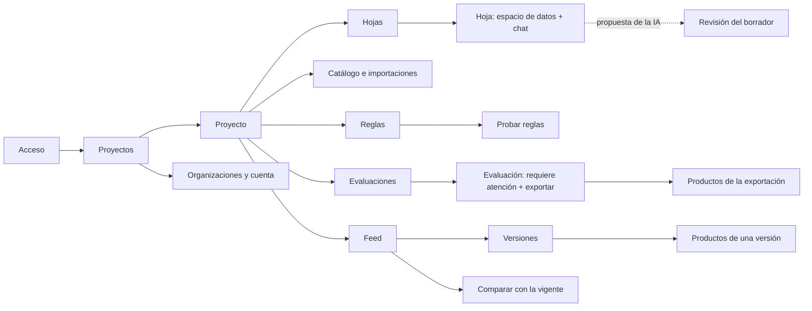

# 04 — Plan: sistema visual, sensación de uso, IA en vivo y mascota

Fecha de creación: 2026-11-14  
Estado: Plan. Va **antes** de las pantallas nuevas (visor y hojas), por petición del usuario.  
Revisión de partida: rama `feature/pruebas-y-cliente-http` (V0 hecha).  
Relacionada con: [ficha ui 06 (maquetación y contraste)](../../fonts/ui/06-maquetacion-sistema-visual-y-contraste.md), [ficha ui 07 (movimiento)](../../fonts/ui/07-movimiento-e-interaccion.md), [ficha assistant 01 (IA en vivo y mascota)](../../fonts/feature/assistant/01-cambios-de-la-ia-en-vivo-y-mascota.md), [ficha ui 03 (Ark UI)](../../fonts/ui/03-ark-ui-tema-y-organizacion-por-funcion.md), [ficha ui 05 (rendimiento)](../../fonts/ui/05-rendimiento-vue-nuxt-y-typescript.md), [16 — tabla central y chat](../../../../docs-diagrams/16-nuxt-tabla-central-chat-y-contratos.md), [15 — chat e IA](../../../../docs-diagrams/15-chat-ia-herramientas-y-propuestas.md), [plan del visor](../feature/feed-viewer/01-plan-visor-y-diagnostico.md), [planes de hojas](../feature/worksheets/).

## Objetivo

Que la web **se vea y se sienta a la altura de la API**: ordenada, clara y fácil de manejar en el ordenador y en el móvil, con respuesta inmediata al pulsar, sin saltos al moverse, y con los cambios de la IA **visibles en vivo** gracias a una mascota propia que hace de «cursor» del asistente, sin estorbar a la persona.

## Principios

1. **El trabajo manda.** En el visor y en las hojas, la tabla ocupa el centro y el máximo espacio; todo lo demás se pliega (documento 16; ficha ui 06, interpretación 3).
2. **Cada acción responde en 0,1 s** con un cambio del propio control, aunque el resultado tarde más (NN/g).
3. **Nada salta.** Lo que entra, sale o cambia de sitio lo hace con una transición corta, solo con `transform` y `opacity` (ficha ui 07).
4. **La IA se ve, pero no manda ni estorba.** Sus lecturas y propuestas se marcan en vivo con su color, icono y etiqueta; nunca mueve el foco ni el desplazamiento de la persona; nada se aplica sin su aprobación (documento 15).
5. **Accesible por defecto.** Contrastes medidos (WCAG 2.2 AA), teclado completo, foco visible, objetivos táctiles amplios y menos movimiento cuando se pide.
6. **Sencillo.** Una sola forma de hacer cada cosa, en el mismo sitio de todas las pantallas.

## Decisión pendiente del usuario: modo por defecto

Hoy el modo por defecto es **oscuro** (`nuxt.config.ts`, por la referencia Focus). El usuario habló del blanco como modo por defecto. Opciones: **claro**, **oscuro** o **el del sistema** (`preference: 'system'`, que sigue la configuración del dispositivo; ficha ui 06, C5). En todos los casos se mantiene el selector manual que ya existe en el menú de la cuenta.

## 1. Color

Valores medidos en la [ficha ui 06](../../fonts/ui/06-maquetacion-sistema-visual-y-contraste.md#medición-de-contraste-del-tema-actual-2026-11-14). Los marcados como **nuevo** corrigen un contraste que hoy no cumple.

| Token (`main.css`)                | Uso                                                  | Claro                                                                                             | Oscuro                                                      |
| --------------------------------- | ---------------------------------------------------- | ------------------------------------------------------------------------------------------------- | ----------------------------------------------------------- |
| `--ui-bg`                         | Fondo de la página y de la tabla                     | `#faf8fb`                                                                                         | `#362e38`                                                   |
| `--ui-bg-muted`                   | Lateral de la app y barras                           | `#efebf1`                                                                                         | `#4c4551`                                                   |
| `--ui-bg-elevated`                | Fila seleccionada, _hover_ de lista, tarjetas        | `#e5dfe8`                                                                                         | `#5f5661`                                                   |
| `--ui-bg-accented`                | Tarjetas resumen                                     | `#d9d2dd`                                                                                         | `#6b626d`                                                   |
| `--ui-text-highlighted`           | Títulos                                              | `#1c161e`                                                                                         | `#fbf7fb`                                                   |
| `--ui-text`                       | Texto normal; **también sobre la fila seleccionada** | `#2b232d`                                                                                         | `#f3eff4`                                                   |
| `--ui-text-toned`                 | Etiquetas de campos                                  | `#4a404d`                                                                                         | `#c9c1cc` (en S0 se mide su separación respecto de `muted`) |
| `--ui-text-muted`                 | Información secundaria (contadores, fechas, ayudas)  | `#6e6472`                                                                                         | **nuevo** `#bfb4c3`                                         |
| `--ui-text-dimmed`                | **Solo** desactivado o decorativo                    | `#8c8290`                                                                                         | `#796f7b`                                                   |
| `--ui-border`                     | Separadores de filas (decorativos)                   | `#e6e0e8`                                                                                         | `#3e3640`                                                   |
| `--ui-border-accented`            | **Borde de campos y controles**                      | **nuevo** `#938b97`                                                                               | **nuevo** `#817988`                                         |
| `--ui-primary`                    | Acción principal, selección propia y enlaces         | **nuevo** violet-600 `#7f22fe`                                                                    | violet-400 `#a684ff`                                        |
| Texto sobre el primario           | Botón principal                                      | `#ffffff` (5,88:1)                                                                                | zinc-900 `#18181b` (6,22:1)                                 |
| `--app-ai` (**nuevo**)            | Texto e iconos de la IA                              | sky-700 `#0069a8`                                                                                 | sky-400 `#00bcff`                                           |
| `--app-ai-outline` (**nuevo**)    | Contorno de lo que lee o propone la IA               | sky-600 `#0084d1`                                                                                 | sky-400 `#00bcff`                                           |
| `--app-ai-wash` (**nuevo**)       | Fondo suave de una celda propuesta                   | `--app-ai-outline` al 12 %                                                                        | `--app-ai-outline` al 18 %                                  |
| Éxito, aviso, error e información | Estados y avisos                                     | Colores semánticos de Nuxt UI; **se miden en S0** con la misma prueba y se corrigen si no cumplen | Ídem                                                        |

**Reglas:**

- **Violeta = lo de la persona** (su selección, su acción principal). **Azul = lo de la IA** (lo que lee y propone). **Verde, ámbar y rojo = estados.** Ningún estado se transmite solo con color: siempre va con icono o texto (WCAG 1.4.1).
- Una celda propuesta por la IA lleva fondo `--app-ai-wash`, contorno de 1 px `--app-ai-outline` y un pequeño icono de la IA en la esquina. Una celda con error lleva contorno rojo e icono de aviso. Una editada por la persona y sin guardar lleva contorno violeta discontinuo.
- **Prueba automática de contraste** (S0): una prueba de Vitest calcula los pares de esta tabla y falla si alguno baja del mínimo (4,5:1 texto, 3:1 controles y contornos).

## 2. Tipografía, espacio, formas y capas

| Elemento                                         | Especificación                                                                                             | Por qué                                                            |
| ------------------------------------------------ | ---------------------------------------------------------------------------------------------------------- | ------------------------------------------------------------------ |
| Familia                                          | La del sistema (SF en macOS), como ya está                                                                 | Identidad Focus y sin descargas                                    |
| Título de vista (plantilla «Documento»)          | `focus-title`: 36–44 px, peso 300                                                                          | Identidad Focus                                                    |
| Título de espacio (plantilla «Espacio de datos») | 18 px, peso 600, una línea con elipsis                                                                     | Deja la altura para la tabla                                       |
| Cuerpo y celdas                                  | 14 px; en el móvil, 16 px en campos editables                                                              | Densidad de una herramienta de datos; legible en el móvil          |
| Números en tablas                                | Cifras tabulares (`tabular-nums`) y alineadas a la derecha                                                 | Comparar importes columna abajo                                    |
| Espaciado                                        | Escala de Tailwind (4 px); filas de tabla de 36 px en escritorio y 44 px en táctil                         | Densidad sin perder objetivos táctiles (WCAG 2.5.8 y 2.5.5)        |
| Radios                                           | `--ui-radius` 0,5 rem (8 px) en controles y paneles; 0 en celdas                                           | Coherencia con Focus; las celdas forman rejilla                    |
| Sombras                                          | Solo en lo que flota: menús, diálogos y toasts                                                             | La profundidad indica qué está encima                              |
| Capas (`z-index`)                                | Contenido 0 · barras fijas 10 · paneles laterales 20 · **mascota 25** · diálogos 30 · menús 35 · toasts 40 | La mascota pasa por encima de la tabla, pero nunca tapa un diálogo |

## 3. Plantillas de página: dónde va cada cosa y por qué

### 3.1 «Documento» (la actual)

Para listas, formularios, ajustes y páginas de resumen: proyectos, organizaciones, cuenta, reglas y evaluaciones.

```text
ESCRITORIO (≥1024)                                  MÓVIL (<640)
┌──────────┬──────────────────────────────────┐    ┌────────────────────┐
│ Lateral  │  Portada ilustrada (176 px)      │    │ ☰  Portada (96 px) │
│ de la app│──────────────────────────────────│    ├────────────────────┤
│ 17 rem   │   Título grande y fino           │    │ Título (32 px)     │
│ plegable │   ┌────────────────────────────┐ │    │ Contenido en filas │
│          │   │ Contenido (máx. 56 rem)    │ │    │ a todo el ancho    │
│          │   └────────────────────────────┘ │    │                    │
└──────────┴──────────────────────────────────┘    └────────────────────┘
```

Por qué: es la identidad Focus (bitácora ui 01) y en textos y formularios una columna estrecha se lee mejor.

### 3.2 «Espacio de datos» (nueva)

Para el visor de productos y las hojas, donde la tabla es el trabajo (documento 16). **Sin portada grande**: una cabecera compacta.

```text
ESCRITORIO AMPLIO (≥1280)
┌──────┬──────────────────────────────────────────────────────────┬─────────────┐
│ App  │ Proyecto / Libro / Hoja ▾        Rev. 12 · Guardado ✓  [Acciones] │ 56 px
│ (ico-├────────────┬─────────────────────────────────────────────┤             │
│ nos o│ Hojas y    │ Buscar · Filtros · Vista ▾ · Importar ·     │  Chat de la │ 48 px
│ 17rem│ vistas     │ Exportar                                    │  hoja       │
│ ple- │ 15 rem     ├─────────────────────────────────────────────┤  24 rem     │
│ gado)│ plegable   │                                             │  plegable y │
│      │            │          TABLA (todo el resto)              │  redimen-   │
│      │            │   cabecera y primera columna fijas          │  sionable   │
│      │            │                                             │  (20–32 rem)│
│      │            ├─────────────────────────────────────────────┤             │
│      │            │ Panel inferior: errores · diferencias ·     │  [mascota]  │
│      │            │ conflictos · revisión (plegable, 30 %)      │  ▢ Mensaje  │
└──────┴────────────┴─────────────────────────────────────────────┴─────────────┘
```

| Zona                          | Qué contiene                                                                                                        | Por qué ahí                                                                                                                             |
| ----------------------------- | ------------------------------------------------------------------------------------------------------------------- | --------------------------------------------------------------------------------------------------------------------------------------- |
| Lateral de la app (izquierda) | Navegación global                                                                                                   | Identidad Focus. En un espacio de datos arranca **plegado en iconos** para dejar sitio a la tabla                                       |
| Cabecera (arriba)             | Dónde estoy (migas), revisión, **estado de guardado** y acciones principales                                        | El documento 16 pide «Revisión 12 · Guardado / Errores» arriba a la derecha; las acciones que afectan a todo van junto a lo que afectan |
| Barra de herramientas         | Buscar, filtros, vistas, importar y exportar                                                                        | Proximidad: lo que cambia la tabla, encima de la tabla                                                                                  |
| Lista de hojas y vistas       | Cambiar de hoja o de vista                                                                                          | Navegación secundaria del espacio, plegable                                                                                             |
| Tabla (centro)                | El trabajo                                                                                                          | Principio 1                                                                                                                             |
| Chat (derecha)                | Conversación del asistente con la **mascota acoplada sobre la caja de mensaje** (como en la referencia del usuario) | Documento 16: chat al lado de los datos que cambia, sin cambiar de página                                                               |
| Panel inferior                | Errores, diferencias, conflictos y revisión                                                                         | Documento 16: panel contextual; abajo no tapa columnas                                                                                  |

**Adaptación** (cortes de Tailwind; ficha ui 06, interpretación 4):

| Ancho     | Comportamiento                                                                                                                                                                                                                                |
| --------- | --------------------------------------------------------------------------------------------------------------------------------------------------------------------------------------------------------------------------------------------- |
| ≥1280     | Las cinco zonas de la figura                                                                                                                                                                                                                  |
| 1024–1279 | Lista de hojas plegada en iconos; chat de 22 rem                                                                                                                                                                                              |
| 768–1023  | Tabla a todo el ancho; el **chat se abre como panel superpuesto** a la derecha (hasta 26 rem, con fondo atenuado) desde un botón con la mascota; el panel inferior, como hoja inferior                                                        |
| <768      | **Una vista a la vez** con pestañas inferiores fijas de 56 px: _Tabla · Chat · Detalle_. La selección se conserva al cambiar (documento 16). La mascota va en la pestaña _Chat_; mientras trabaja, la pestaña muestra su cara y un punto azul |

### 3.3 «Panel lateral»

Ficha de producto, detalle de una fila y, en tableta, el chat. Un `Dialog` de Ark a la derecha, de 28 rem en escritorio y **a pantalla completa en el móvil**, con su URL (`?producto=…`) y el foco devuelto al cerrar (plan del visor, VW7).

### 3.4 El visor en esta plantilla

Cabecera: «Productos · Versión 7 (publicada el …)» y la descarga. Barra: búsqueda y origen (exportación o versión). Tabla: imagen 40 px, ID, título, precio y disponibilidad. Ficha: panel lateral. En el móvil, la tabla pasa a **lista de tarjetas** (imagen, título, precio y estado), porque cinco columnas no caben en 320 px (WCAG 1.4.10).

## 4. Flujo de la web entera



- **Navegación del proyecto** (`ProjectNav`), en el orden del recorrido: **Hojas** (pre) · Catálogo · Reglas · Evaluaciones · Feed · **Productos** (post; abre la versión publicada o, si no hay, la última exportación).
- El **chat del proyecto** está disponible en las hojas y en productos; en el resto de páginas, un botón con la mascota lo abre como panel lateral.

## 5. Sensación al usar: estados de cada control

| Control                        | Reposo                              | _Hover_ (solo puntero fino)                                   | Pulsado                                         | Foco de teclado                                  | Desactivado                                 | Ocupado                                                                |
| ------------------------------ | ----------------------------------- | ------------------------------------------------------------- | ----------------------------------------------- | ------------------------------------------------ | ------------------------------------------- | ---------------------------------------------------------------------- |
| Botón principal                | Fondo primario, texto de contraste  | Fondo un paso más oscuro (claro) o más claro (oscuro), 100 ms | `scale(0.98)` + fondo de pulsado, **inmediato** | Contorno de 2 px primario con 2 px de separación | Opacidad 50 %, sin _hover_, `aria-disabled` | Icono → indicador giratorio; **mismo ancho** (sin saltos); `aria-busy` |
| Botón secundario o fantasma    | Borde `border-accented` o sin fondo | `bg-elevated`, 100 ms                                         | `scale(0.98)`                                   | Ídem                                             | Ídem                                        | Ídem                                                                   |
| Fila de lista o de tabla       | Separador tenue                     | `bg-elevated` al 60 %, 100 ms                                 | `bg-elevated`                                   | Contorno interior de 2 px primario               | —                                           | —                                                                      |
| Celda de la hoja               | Rejilla                             | Sin cambio (evita ruido al mover el ratón)                    | —                                               | Contorno de 2 px primario (celda activa)         | `aria-readonly`, texto normal               | Celda guardándose: punto animado en la esquina                         |
| Campo                          | Borde `border-accented` (3:1)       | Borde un paso más marcado                                     | —                                               | Contorno de 2 px primario                        | Fondo `bg-muted`                            | —                                                                      |
| Pestaña o enlace de navegación | Texto `muted`                       | Texto normal                                                  | —                                               | Contorno                                         | —                                           | —                                                                      |
| Interruptor o casilla          | Ark (`Switch`, `Checkbox`)          | —                                                             | Cambio de estado en 100 ms                      | Contorno                                         | —                                           | —                                                                      |

- **Objetivos táctiles:** 44×44 px con puntero grueso (`pointer-coarse:`) y al menos 24×24 px en escritorio (WCAG 2.5.5 y 2.5.8).
- **Tiempos de respuesta** (NN/g): el control responde en **≤0,1 s** siempre; si el resultado tarda **más de 1 s**, aparece un indicador (esqueleto en cargas y giratorio en acciones); si pasa de **10 s** (importar, evaluar), progreso con etapas, como ya hacen los trabajos.
- **Sin parpadeos** (propuesta propia, se comprueba en S2): un esqueleto que aparece se mantiene al menos 300 ms.

## 6. Movimiento

| Token               | Valor                           | Para qué                                                  | Fuente                                                  |
| ------------------- | ------------------------------- | --------------------------------------------------------- | ------------------------------------------------------- |
| `--motion-instant`  | 100 ms                          | Respuesta de controles                                    | NN/g                                                    |
| `--motion-quick`    | 150 ms                          | Aparecer y desaparecer algo pequeño (tooltips, insignias) | NN/g, rango 100–400                                     |
| `--motion-standard` | 200 ms                          | Filas, menús y paneles pequeños                           | NN/g                                                    |
| `--motion-emphasis` | 250 ms                          | Diálogos y paneles laterales                              | NN/g, 200–300 para un modal                             |
| `--motion-travel`   | 450 ms                          | La mascota cruzando la pantalla                           | NN/g, hasta 500 en movimientos grandes                  |
| `--ease-enter`      | `ease-out`                      | Lo que entra                                              | NN/g                                                    |
| `--ease-exit`       | `ease-in` (y un 20 % más corto) | Lo que sale                                               | NN/g                                                    |
| `--ease-move`       | `ease-in-out`                   | Desplazar algo que ya está a la vista                     | Curso de Flutter, lección 33; CSS Completo, lección 257 |

| Animación                              | Cómo                                                                                    | Con menos movimiento                      |
| -------------------------------------- | --------------------------------------------------------------------------------------- | ----------------------------------------- |
| Pulsar                                 | `scale(0.98)`, instantáneo                                                              | Solo el color                             |
| Diálogo y panel lateral                | Opacidad + `translateX(16px)` → 0, 250 ms al entrar y 200 ms al salir                   | Solo la opacidad, 150 ms                  |
| Menús y tooltips                       | Opacidad + `translateY(4px)`, 150 ms                                                    | Solo la opacidad                          |
| Filas que entran, salen o se reordenan | `<TransitionGroup>` con `move`, 200 ms; escalonado de 20 ms con tope de 300 ms en total | Sin desplazamiento: aparecen con opacidad |
| Cambio de página                       | View Transitions de Nuxt (`experimental.viewTransition`), fundido de 200 ms             | Desactivado solo por Nuxt                 |
| Celda propuesta por la IA              | Fondo `--app-ai-wash` que entra en 250 ms y se queda, con contorno e icono              | El fondo aparece sin transición           |
| Guardado del borrador                  | «Guardando…» → «Guardado ✓» con fundido de 150 ms                                       | Igual (solo opacidad)                     |

**Ajuste propio de la app** (WCAG 2.3.3): «Movimiento: completo / reducido», guardado en el navegador, además de respetar `prefers-reduced-motion`. **Rendimiento:** solo `transform` y `opacity`, sin `will-change` salvo medición, y nada animado con la pestaña oculta (ficha ui 07).

## 7. Cambios de la IA en vivo

Correspondencia entre los eventos de una ejecución (documento 15) y lo que se ve:

| Evento                                     | Mascota                                  | En la interfaz                                                                                     | Región viva (`polite`)                         |
| ------------------------------------------ | ---------------------------------------- | -------------------------------------------------------------------------------------------------- | ---------------------------------------------- |
| `run.started`                              | Despierta y se pone a pensar en su sitio | La caja de mensaje muestra «Detener»                                                               | «El asistente está trabajando»                 |
| `status`                                   | Pensando                                 | Texto de estado bajo el último mensaje                                                             | — (evita ruido)                                |
| `tool.started` (lectura)                   | **Viaja** a la zona del `target` y mira  | Contorno azul discontinuo en la zona leída (filas o columnas), sin tapar datos                     | «Leyendo Precio de 120 filas»                  |
| `tool.completed` (lectura)                 | Vuelve a pensar                          | El contorno se desvanece en 200 ms                                                                 | —                                              |
| `tool.started` (preparar una escritura)    | Viaja y **escribe**                      | Celdas del borrador con fondo azul suave, contorno e icono, apareciendo con el escalonado de la §6 | —                                              |
| `proposal.ready` / `confirmation_required` | **Señala** el botón de revisar           | Tarjeta de propuesta en el chat con el resumen de Nest y «Revisar cambios»                         | «Hay una propuesta de 12 cambios para revisar» |
| `needs_clarification`                      | Pregunta (cara de duda)                  | La pregunta, resaltada en el chat                                                                  | «El asistente necesita una aclaración»         |
| `run.completed`                            | Contenta 600 ms y vuelve a reposo        | Fin del estado «trabajando»                                                                        | «El asistente terminó»                         |
| `run.failed` / `limit_reached`             | Preocupada, sin temblar                  | Mensaje de error con «Reintentar»                                                                  | El mensaje del error                           |
| `run.cancelled`                            | Vuelve a reposo                          | —                                                                                                  | «Ejecución detenida»                           |

**Reglas:**

- La persona **siempre manda:** «Detener» visible durante toda la ejecución; la IA nunca mueve el foco ni el desplazamiento; si la zona está fuera de la vista, la mascota espera en el borde de la tabla con una flecha y un botón «Ir allí».
- Muchos cambios a la vez (más de 50 celdas): marcas en bloque con un solo fundido; la mascota «escribe» un momento y sigue. Nunca se hace esperar a los datos por la animación.
- Lo propuesto **no es oficial** hasta que se aprueba (revisión del borrador en el plan TE de hojas).
- **Requisito para E6.4 (Nest y servicio de IA):** cada evento `tool.started` y `tool.completed` debe traer `target` (tipo e IDs: hoja, filas y columnas, evaluación o feed), sacado por Nest de los argumentos ya validados (documento 15, `ai_tool_calls`) y nunca del texto del modelo. Se anotará en el plan de E6.4.

## 8. La mascota

| Aspecto               | Especificación                                                                                                                                                                                                                                                                                                                 |
| --------------------- | ------------------------------------------------------------------------------------------------------------------------------------------------------------------------------------------------------------------------------------------------------------------------------------------------------------------------------ |
| Concepto              | **Personaje propio** inspirado en la referencia del usuario: pixel art, cara de pantalla con ojos de píxel que expresan el estado y un aire de terminal (`>_`). Silueta distinta: una nubecita compacta con una antena en forma de **cursor de texto** (`                                                                      | `), porque es el cursor de la IA. Nombre: lo elige el usuario |
| Dibujo                | SVG de píxeles en el código: rejilla de **24×24** píxeles lógicos, `shape-rendering="crispEdges"` y escalas enteras (×2 = 48 px acoplada; ×1,5 no)                                                                                                                                                                             |
| Paleta                | Cinco colores como variables CSS: contorno, cuerpo (familia sky, la de la IA), luz, pantalla (zinc-900) y ojos o brillo; con valores propios en cada modo para que se distinga sobre los dos fondos                                                                                                                            |
| Estados y fotogramas  | Reposo (2; parpadeo cada 5–7 s) · Pensando (3, puntos en la pantalla, 6 fps) · Leyendo (2, ojos que recorren, 4 fps) · Viajando (1, inclinada) · Escribiendo (4, el cursor parpadea y «teclea», 8 fps) · Señalando (2) · Contenta (1, 600 ms) · Preguntando (1) · Preocupada (1) · Dormida (1: pausada, oculta o sin conexión) |
| Dónde vive            | Acoplada sobre la caja de mensaje del chat, a la izquierda (como en la referencia). En el móvil, en la pestaña _Chat_                                                                                                                                                                                                          |
| Cómo se mueve         | Viaja con `element.animate()` (`transform: translate`) durante `--motion-travel` con `--ease-move` hasta junto a la zona del `target` (ancla `data-ai-anchor`), arriba a la derecha y **sin taparla**; al terminar vuelve a su sitio. Sin escalados ni rebotes                                                                 |
| Lo que nunca hace     | Recibir clics (`pointer-events: none`), tapar el elemento con el foco (WCAG 2.4.11), mover el foco o el desplazamiento, sonar o tapar un diálogo (capa 25)                                                                                                                                                                     |
| Accesibilidad         | `aria-hidden="true"`: la información va en el chat y en la región viva                                                                                                                                                                                                                                                         |
| Control de la persona | Ajuste «Mascota: animada / quieta / oculta» (WCAG 2.2.2); con menos movimiento queda **quieta**: cambia de cara sin viajar. Con la pestaña oculta se pausa (Page Visibility)                                                                                                                                                   |
| Presupuesto           | Menos de 8 KB entre componente y fotogramas; **cero dependencias**; un solo bucle de animación; solo `transform` y `opacity`; ninguna tarea larga (≥50 ms) al viajar, comprobado con `PerformanceObserver`                                                                                                                     |
| Código                | `components/assistant/AssistantMascot.vue` (dibujo), `utils/assistant/mascot-frames.ts` (rejillas de cada fotograma), `utils/assistant/mascot-state.ts` (máquina de estados pura: evento → estado) y `composables/assistant/useMascotTravel.ts` (viajes, pausa y menos movimiento)                                             |
| Laboratorio           | Página **solo de desarrollo**, `/laboratorio/mascota`, con botones que simulan los eventos, para que el usuario apruebe el aspecto y la sensación **antes** de conectarla a la IA real                                                                                                                                         |

## Etapas

| Etapa  | Qué                                                                                                                               | Comprobación prevista                                                                                        | Cuándo                                                                 |
| ------ | --------------------------------------------------------------------------------------------------------------------------------- | ------------------------------------------------------------------------------------------------------------ | ---------------------------------------------------------------------- |
| **S0** | Tokens de color corregidos, color de la IA, regla de textos, **prueba automática de contraste** y decisión del modo por defecto   | Prueba de contraste en verde en los dos modos; capturas antes y después                                      | Antes de V1                                                            |
| **S1** | Plantillas «Documento», «Espacio de datos» y «Panel lateral»; `ProjectNav` con Hojas y Productos; adaptación a 1280/1024/768/<768 | Capturas en 1440, 1024, 768 y 375 px, en claro y oscuro; sin desplazamiento horizontal a 320 px              | Antes de V1                                                            |
| **S2** | Estados de interacción (§5), tokens de movimiento (§6), menos movimiento (sistema y ajuste propio) y View Transitions             | Pruebas de los estados con `mountSuspended`; emulación de menos movimiento; teclado; ninguna tarea larga     | Antes de V1                                                            |
| **M0** | Mascota: dibujo, paleta y estados en el laboratorio                                                                               | **Aprobación del usuario** del personaje; pruebas de la máquina de estados; `aria-hidden` y `pointer-events` | En paralelo con V1                                                     |
| **M1** | Viajes y marcas de lectura y propuesta con **eventos simulados** sobre una tabla de prueba en el laboratorio                      | Medición de rendimiento (sin tareas largas), menos movimiento, foco nunca tapado y zona fuera de la vista    | En paralelo con V2–V5                                                  |
| **M2** | Conexión con los eventos reales de E6.4 en el chat y en las hojas                                                                 | Recorrido real: pedir un cambio, verlo en vivo, revisarlo y aprobarlo                                        | Cuando existan E6.2, E6.3a y E6.4 (Nest y servicio de IA) con `target` |

En cada etapa: bitácora, pruebas, defectos a propósito, verificación completa y **capturas en el navegador** (claro, oscuro, escritorio y móvil) como prueba visual.

## Límites

- No se cambia la identidad Focus: se corrige el contraste y se añaden la plantilla de datos y la capa de la IA.
- El dibujo final de la mascota lo aprueba el usuario en M0; este plan fija su técnica, sus estados y sus reglas.
- Lo que depende del contrato de E6.4 (el `target` de los eventos) se pide a esa etapa; mientras tanto, M0 y M1 funcionan con eventos simulados.
